# Tabstitch

**Don’t trust the fix. Replay the journey.**

A local behavioral accessibility repair workbench. Freeze a task and its functional outcomes, reproduce a real keyboard failure, apply a bounded patch in a disposable copy, replay the same journey, and export inspectable evidence. NVIDIA Nemotron through Nebius Token Factory can propose the source repair; deterministic execution owns the verdict.

**Start with the case studies at the top of the app.** Three bundled recordings show a scanner-clean keyboard failure, a superficially improved candidate that breaks the functional result, and a real historical a11y-dialog focus defect. Before/after screenshots, focus paths and source changes are directly inspectable. Use **Presentation view** for the short pitch, then **Run a fresh browser journey** for actual execution. The recordings are explicitly labeled; none claims a live AI call. Regenerate them from existing measured artifacts with `node scripts/build-casebook.js`.

**Current status:** functional local reference-replay system, not a completed competition submission. No live Nebius inference has been run. Seven synthetic apps share two principal defect families. One historical defect is replayed with its published human repair. No autonomous repair rate, independent holdout performance, full framework support or accessibility conformance is claimed. See [FINAL_AUDIT.md](FINAL_AUDIT.md) for measured release status.

## Run locally

Requires Node **24.19+**, npm, and a desktop OS supported by Playwright. No GPU, Docker, database service or API key is needed for the reference mode. Browser binaries are a free download. Historical source snapshots and licenses are included; normal setup does not fetch or execute third-party project install scripts.

```powershell
npm ci --ignore-scripts
npx playwright install chromium
npm run check
npm test
npm run test:browser
npm start
```

Open **http://127.0.0.1:4317**. Select a journey and **Reference patch replay · no AI**, then run the proof. This mode is intentionally labeled: the author-supplied patch tests the verifier; it is not an AI-generated repair. Select checkpoints to review the failure, exact source diff and replay. Download a `.tar.gz` bundle. Reloading restores the latest run.

```powershell
npm run benchmark
npm run journey -- --fixture checkout --reference
npm run journey -- --fixture checkout --discover
npm run journey -- --source C:/path/to/trusted-static-app --journey C:/path/to/journey.json
npm run proof:verify -- artifacts/runs/RUN_ID
```

The authored journey JSON contract is illustrated in `fixtures/checkout/journey.json`. The CLI runs static HTML/CSS/classic JS and browser ESM; it never installs dependencies or executes a repository server. Discovered intents require explicit human-authored postconditions before becoming executable journeys. `fromTestContract` imports application test contracts without rewriting assertions.

## Live Nebius / NVIDIA mode

1. Obtain official sponsor/free Token Factory credits and confirm the account cannot silently incur paid overages. The app cannot inspect your billing settings.
2. Copy `.env.example` to `.env`; keep the file private. Set `NEBIUS_API_KEY`, `LIVE_NEBIUS_TESTS=true`, and `NEBIUS_SPONSOR_CREDITS_CONFIRMED=true` only after that confirmation.
3. Run `npm run live:smoke` to list available NVIDIA Nemotron IDs. Set `NEBIUS_MODEL` to an exact returned ID. Model cards advertised on the web do not establish account-specific availability.
4. Run `npm run live:smoke -- --repair` for **one bounded repair attempt**, or choose the live provider in the workbench. Restart the server after changing `.env`.

No missing-credential fallback is called AI. Errors and truncated/malformed output remain unverified. The provider uses strict JSON schema, allowlisted source files, source hashes, timeouts, a persistent token reservation ledger, cached identical requests and a process/cross-process budget lock. Model-specific structured-output compatibility remains untested until credentials are provided. No retries are silently made after provider failures. Default repair loop maximum is two, bounded to three.

The `artifacts/inference/budget.json` ledger reserves a conservative maximum before each completion and never refunds failed/unknown requests. It is a token/call guard, not an authoritative USD credit balance. Do not delete it to bypass an exhausted budget. Ordinary tests use local injected transport contracts and make zero provider calls.

## How a repair earns a verdict

```mermaid
flowchart LR
  J[Frozen journey + functional oracle] --> B[Clean browser baseline]
  B --> E[Failure + focus + AX + axe evidence]
  E --> L[Rank bounded source candidates]
  L --> N[Nemotron on Nebius or labeled reference patch]
  N --> P[Validate and patch isolated copy]
  P --> C[Static syntax and structure checks]
  C --> R[Replay identical journey]
  R --> F[Independent pointer functional replay]
  F --> V[Task / oracle / environment / rule / visual gate]
  V --> A[Hashed proof bundle]
```



Keyboard actions use actual Tab, Shift+Tab, Enter, Space, Escape and arrow keys. Target seeking never calls `focus()` or clicks in a keyboard journey. A bounded Tab budget produces a real unreachable-control failure. Dialog tasks also check focus entry, both wrap directions, Escape and restoration. Every attempted action has before/after focus and expected-state evidence. Fresh browser contexts use fixed locale, timezone and viewport.

Evidence includes screenshots, DOM, Playwright ARIA snapshots, Chromium AX trees, axe violations/incomplete/passes/inapplicable, focus transitions, explicit postconditions, runtime errors, source hashes, patch, build checks, coarse initial-page visual comparison and verification reasons. The four verdicts are `VERIFIED_PASS`, `VERIFIED_FAIL`, `INCONCLUSIVE`, `NOT_TESTED`. A passing journey can still have rule findings; the repair gate also rejects newly introduced automated findings. Existing unrelated findings remain visible.

Probe profiles include semantics, 640/320 CSS-pixel reflow equivalents, reduced motion and forced colors. These are separate assertions; they do not simulate disability or reproduce every assistive configuration. AX snapshots are **not real screen-reader testing**. **Zero axe violations does not mean full accessibility.**

## Evaluation

`npm run benchmark` executes seven paired applications, two actual negative source patches, verifier mutations, 120 focused browser pairs across 12 correlated families, and one pinned historical focus-restoration defect. Machine-readable results are in `benchmarks/results.json`; per-run artifacts are local under `artifacts/benchmark/`. See [methodology](docs/benchmark_methodology.md). Historical human fixes are never labeled as agent-generated. No holdout score exists.

## Security and deployment

Default server binds loopback and rejects foreign Host headers and cross-origin writes. Public mode requires a judge token of at least 24 characters, one active run, bounded storage and a global run rate limit. It accepts only bundled fixture IDs and providers, not arbitrary URLs, commands or repositories. Browser network traffic is restricted to its fixture origin; CSP blocks external connections and framing. Credentials never reach browser environments or the frontend.

`Dockerfile` provides a reproducible self-host configuration. Docker execution has not been validated on this workstation. An always-on public Chromium service is not deployed. Do not expose arbitrary repository execution: current local mode is a static-app runner, not a hardened untrusted-code sandbox. See [threat model](docs/threat_model.md).

## Limits that matter

- Current benchmarked runtime surface: static HTML/CSS/JS. React/Next.js/Vue/Svelte/Angular builds are not supported or benchmarked. Source ranking is bounded static text matching, not AST/component/source-map localization.
- No actual NVDA, VoiceOver, JAWS, Firefox or WebKit verification.
- Reflow is an equivalent viewport probe, not actual 200/400% browser zoom. Motion and forced-color checks are narrow, not comprehensive audits.
- Visual comparison gates large initial-page changes; it does not establish all-state visual equivalence.
- Public inference, quota during judging, model routing and model repair reliability remain untested. No paid infrastructure has been purchased.
- Hashes detect artifact changes; they do not authenticate the publisher or replace a reproducible independent rerun.

MIT for our code. Historical upstream material retains its own MIT notices in `benchmarks/historical/**/LICENSE` and `upstream-dependency/LICENSE`. Playwright (Apache-2.0), axe-core (MPL-2.0), Zod (MIT) and pngjs (MIT) retain their respective licenses in dependencies.
